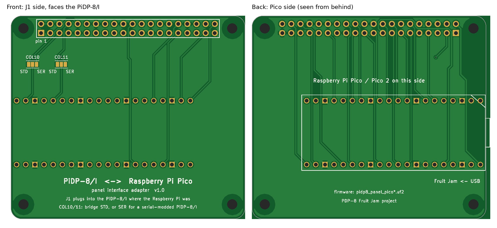

# PiDP-8/I ↔ Raspberry Pi Pico adapter board

This board replaces the 26 jumper wires between a PiDP-8/I and the Pico panel interface. It is
the size of a Raspberry Pi HAT (65 × 56.5 mm), with the Pi's four M2.5 mounting holes. Its
40-pin connector sits where the Pi's GPIO header would be, so it plugs into the PiDP-8/I exactly
where the Raspberry Pi did. The Pico (or Pico 2) is soldered to the **back**. Its USB connector
sticks out at one edge for the cable to the Fruit Jam, and its BOOTSEL button stays reachable.



| File | What it is |
|---|---|
| `pidp8-pico-adapter-gerbers.zip` | upload this to JLCPCB, PCBWay, OSH Park, etc. |
| `pidp8-pico-adapter-1to1.pdf` | print at 100 % to check the fit before ordering |
| `pidp8-pico-adapter-schematic.pdf` | schematic |
| `pidp8-pico-adapter.kicad_pcb` / `.kicad_sch` / `.kicad_pro` | KiCad 7 project, if you want to change it |
| `make_board.py`, `route.py`, `render.py`, `make_schematic.py`, `check_board.py` | the scripts that generate everything |

## Ordering

These are standard settings everywhere: 2 layers, 1.6 mm, any colour, HASL finish. The smallest
features are 0.25 mm tracks with 0.2 mm spacing and 0.35 mm vias, well within every cheap service.
At JLCPCB, five boards cost a few dollars plus shipping.

## Parts

| Ref | Part |
|---|---|
| J1 | 2×20 header, 2.54 mm. Use what a Raspberry Pi would present: normally a **male** pin header (the PiDP-8/I has the socket). If your PiDP-8/I has pins instead, use a 2×20 female socket. |
| U1 | Raspberry Pi Pico, Pico 2 (or the W versions), with two 1×20 male headers, or soldered flat by its castellations |
| JP1, JP2 | solder bridges (no parts) |
| — | 4 × M2.5 standoffs, as for the Pi (optional) |

## Assembly

1. **Jumpers first.** On the front, bridge the middle pad of JP1 and JP2 with a blob of solder:
   * to **STD** for a normal PiDP-8/I,
   * to **SER** if your PiDP-8/I has the serial-port modification (columns 10 and 11 then come
     from header pins 5 and 3 instead of 10 and 8; see `pidp8-panel/README.md`).

   Never bridge all three pads.
2. **J1 on the front** (the side with the jumpers and the big title). It faces the PiDP-8/I.
   Solder it on the back.
3. **The Pico on the back.** Match the silkscreen outline, with the USB connector at the board
   edge. Pin 1 is at the corner with the bevel. Solder on the front.
4. Flash `pidp8_panel_pico.uf2` or `pidp8_panel_pico2.uf2` (v1.2 or later), then plug the board
   into the PiDP-8/I in place of the Raspberry Pi. Don't fit both at once.

## How the firmware knows

The board ties the Pico's **GP28 to ground**. At start-up the panel firmware sees that and uses
this board's GPIO assignment, recorded in `pidp8-panel/board_map.h`. With GP28 left open, as when
hand-wired, it uses the original table from the panel README. One firmware file works both ways.

Each matrix line on the board goes to whichever Pico GPIO sits closest to its header pin, so the
tracks hardly cross. `make_board.py` makes that choice and writes `board_map.h` at the same time,
so the board and the firmware can't disagree. `check_board.py` then follows every connection on
the finished board, through the jumpers, and compares it with the PiDP-8/I's wiring as the pidp8i
software defines it and with `board_map.h`.

## Status

The board was generated, autorouted (Freerouting) and checked by script:
* KiCad's DRC reports no errors and no unconnected items. The only warnings are cosmetic: the Pico
  outline's USB tab overhangs the edge, and the footprints are generated rather than taken from a
  library.
* `check_board.py` passes.
* The gerbers were re-rendered with gerbv to confirm they are complete.

**It has not been built yet.** Before ordering, print the 1:1 PDF and hold it against the PiDP-8/I.
Check that the 40-pin connector lines up with its socket and that the mounting holes match. Also
check that nothing on the PiDP-8/I side gets in the way of the board where the Pi used to be.

## Regenerating

```sh
FREEROUTING_JAR=/path/to/freerouting-1.9.0.jar python3 route.py
```

This needs KiCad 7 (its `pcbnew` Python module and `kicad-cli`), Java 17+,
[Freerouting](https://github.com/freerouting/freerouting) 1.9, plus scipy, cairosvg and Pillow.
`xvfb-run` is used automatically on a headless machine. If you change the GPIO assignment,
rebuild the panel firmware (`make panel`) so it picks up the new `board_map.h`.
